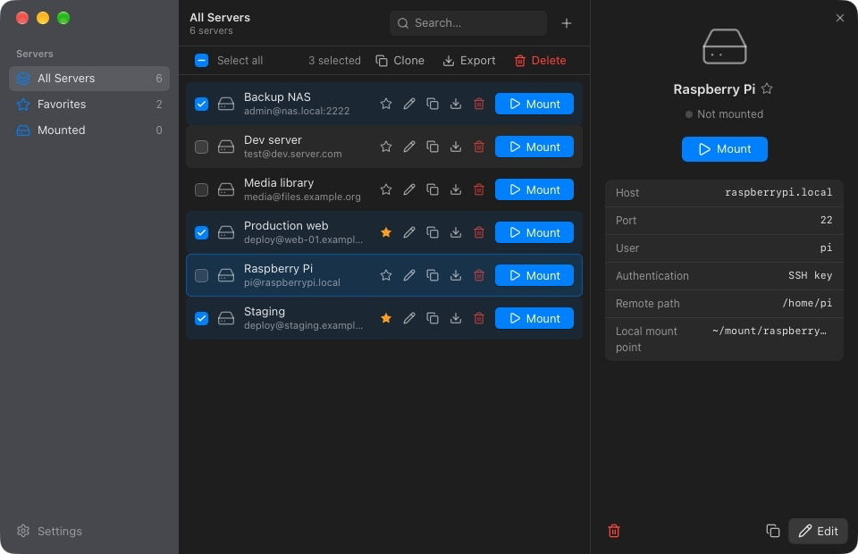

<p align="center">
  
</p>

<h1 align="center">SSHFS GUI</h1>

<p align="center">
  A simple macOS app to mount remote filesystems over SSH.<br>
  No terminal needed: point, click, and browse your remote files in Finder.
</p>

<p align="center">
  
  <a href="https://github.com/tommasomeli/sshfsgui/releases"></a>
  
  <a href="./LICENSE"></a>
  <a href="https://buymeacoffee.com/tommasomeli"></a>
</p>

<p align="center">
  
</p>

---

## Features

- **Batteries included** - sshfs and FUSE-T are built in, no extra installs
- **Multiple servers** - Save, edit, clone, and organize as many SSH connections as you need
- **One-click mount/unmount** - Mount remote directories to local folders with a single click
- **Favorites & filters** - Star your most-used servers, filter by favorites or mounted status
- **Auto-mount on startup** - Automatically reconnect to selected servers when the app launches
- **Secure credential storage** - Passwords are stored in the macOS Keychain, never in plain text
- **Multiple auth methods** - SSH agent, SSH key, or password authentication
- **Menu bar mode** - Optionally run as a menu bar app with quick access from the tray icon
- **Import / Export** - Transfer server configurations and settings between machines via JSON
- **Bulk actions** - Select servers with checkboxes or by dragging, then clone, export, or delete them at once
- **Multi-language** - English and Italian, with automatic detection or manual override
- **Native macOS look** - Translucent sidebar, system light/dark theme and accent color, native menus
- **Reveal in Finder** - Open mounted directories directly in Finder

## Requirements

macOS 12 or later. SSHFS GUI ships with everything it needs to mount: `sshfs` and [FUSE-T](https://www.fuse-t.org), which works without kernel extensions. Nothing else to install, and it runs alongside any sshfs, macFUSE or FUSE-T already on your Mac.

## Installation

Download the latest `.dmg` from [Releases](https://github.com/tommasomeli/sshfsgui/releases), open it, and drag **SSHFS GUI** to your Applications folder.

## Usage

### Adding a server

1. Click **+** in the toolbar (or press `⌘N`)
2. Fill in the connection details:
   - **Name** - A friendly label (e.g. "Production DB")
   - **Host** - Hostname or IP address
   - **Port** - SSH port (default: 22)
   - **User** - SSH username
   - **Remote path** - The directory to mount (e.g. `/var/www`)
   - **Local mount point** - Where to mount it locally (e.g. `~/mnt/prod`)
3. Choose an authentication method:
   - **SSH agent** - Uses your running `ssh-agent`
   - **SSH key** - Specify a private key file
   - **Password** - Stored securely in macOS Keychain
4. Click **Create server**

### Mounting

Click **Mount** on any server row. A green dot marks an active mount; click **Unmount** to disconnect. The folder icon reveals the mount in Finder.

Click a row to open its details in the side panel, which you can resize by dragging its edge. Double-click a row to edit it, right-click for the context menu.

### Selecting several servers

Tick the checkboxes or drag a rectangle over the list. The bar above the list then offers **Clone**, **Export**, and **Delete** for the selection.

### Settings

Open settings from the sidebar or with `⌘,`:

- **Language** - System, English, or Italian
- **Launch at login** - Start the app when you log in
- **Unmount all on quit** - Disconnect everything when closing
- **Show in menu bar** - Run as a tray app (release builds)
- **Import / Export** - Transfer servers and settings as JSON

## Development

Requirements: [Node.js](https://nodejs.org/) 20+, [pnpm](https://pnpm.io/) 10+, a stable [Rust](https://www.rust-lang.org/tools/install) toolchain, and for release builds `meson` and `ninja` (`brew install meson ninja`).

```bash
pnpm install
pnpm dev
pnpm test
pnpm run lint
pnpm run build:mac
pnpm run icons
```

`pnpm run icons` regenerates `src-tauri/icons` from `resources/icon.svg`.

Release builds run [`scripts/fuse-t/build-bundled-sshfs.sh`](scripts/fuse-t/build-bundled-sshfs.sh) first: it downloads pinned sources, builds sshfs against FUSE-T with a static GLib, and stages the files that go inside the app. `pnpm dev` uses the `sshfs` found on your system.

`pnpm demo:seed` swaps your servers for a demo set (for screenshots) and `pnpm demo:restore` puts yours back. Quit the app before running either.

Releases are published from GitHub on a push to `main`, or from a Mac with `pnpm release:local`: see [Releases](CONTRIBUTING.md#releases).

Shared metadata lives in `src/shared/`:
- `app-info.json` - product name, app id, slug, developer, GitHub URL, description, export format version
- `system-instructions.json` - Homebrew install guidance
- `sshfs-defaults.json` - default `sshfs` `-o` flags
- `src/locales/*.json` - UI and native menu strings

App **version** lives in `package.json` only. `pnpm run sync:meta` (also run by `dev` / `build`) aligns `Cargo.toml`, `Cargo.lock`, `tauri.conf.json`, and npm package metadata.

### Tech stack

- [Tauri 2](https://v2.tauri.app/) + [Vite](https://vite.dev/)
- [React](https://react.dev/) + [TypeScript](https://www.typescriptlang.org/)
- [Tailwind CSS](https://tailwindcss.com/) + [shadcn/ui](https://ui.shadcn.com/)
- [Zustand](https://zustand.docs.pmnd.rs/) for state management
- [i18next](https://www.i18next.com/) for internationalization
- [keyring](https://crates.io/crates/keyring) for macOS Keychain

## Contributing

See [CONTRIBUTING.md](CONTRIBUTING.md). Bug reports and feature requests use the GitHub issue templates.

## License

[ISC](LICENSE) - Tommaso Meli

The app bundles third-party software under its own licenses: [sshfs](https://github.com/macos-fuse-t/sshfs) (GPL-2.0), [FUSE-T](https://www.fuse-t.org) (FUSE-T license, libfuse under LGPL) and [GLib](https://gitlab.gnome.org/GNOME/glib) (LGPL-2.1). License texts and source links are in `SSHFS GUI.app/Contents/Resources/third-party/`.
